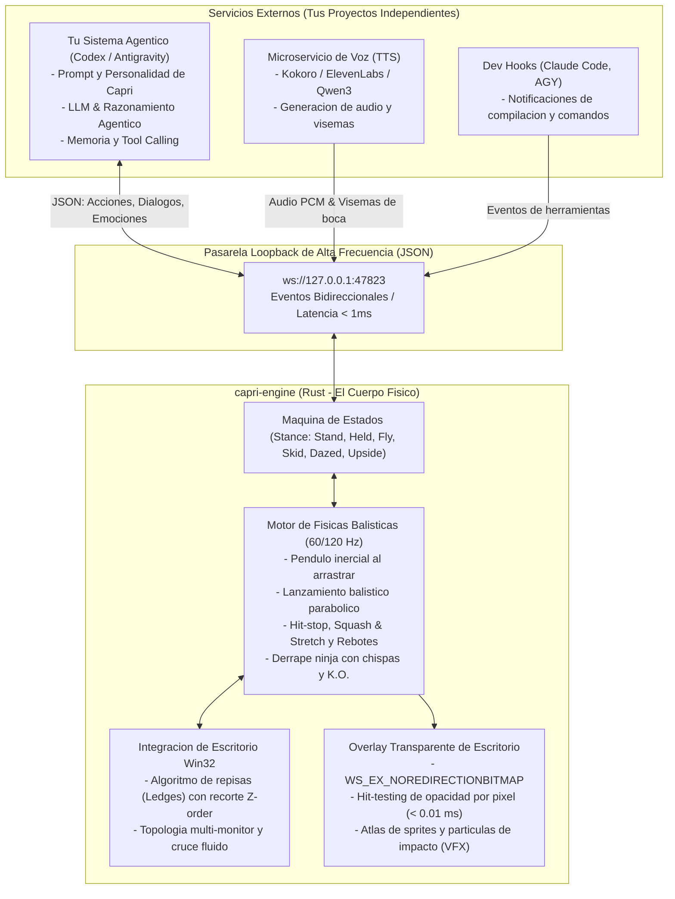

[English](README.md) · **Español**

# Capri Engine (`capri-engine`)
### Motor de Fisicas Balisticas, Lienzo de Escritorio y Pasarela Modular para Constructos de IA

[](https://www.rust-lang.org/)
[](LICENSE.md)
[]()
[]()

> **Capri Engine** es el **Cuerpo Fisico y Lienzo Interactivo de Escritorio** (*The Embodied Desktop Host & Physics Canvas*) de **Capri** (*Project Capricorn*, de *Cyberpunk: Edgerunners*). 
> 
> Disenado en **Rust nativo** con arquitectura modular orientada a servicios, desacopla completamente la simulacion fisica de alta frecuencia y el renderizado transparente del cerebro de inteligencia artificial (LLM) y de los servicios de voz (TTS/STT).

---

## 1. Filosofia de Arquitectura: Separacion Cuerpo vs. Mente

Capri Engine implementa una arquitectura desacoplada donde el motor de simulacion fisica y renderizado nativo opera como un proceso independiente de alto rendimiento (el cuerpo fisico), comunicandose con los agentes externos de inteligencia artificial, servicios de voz (TTS) y herramientas de desarrollo exclusivamente a traves de una pasarela WebSocket loopback (`ws://127.0.0.1:47823`).

Esta separacion garantiza que la simulacion fisica y la interactividad en el escritorio se mantengan fluidas a 60/120 FPS sin bloqueos, independientemente del tiempo de procesamiento o inferencia de los sistemas cognitivos externos.



### Ventajas de esta Arquitectura:
- **Cero latencia y maxima fluidez**: El motor fisico corre a 60/120 FPS sin inmutarse, consumiendo ~15-25 MB de memoria y 0% de CPU en reposo.
- **Libertad poliglota**: Tu agente puede estar escrito en Python, TypeScript, Go o C#; solo necesita enviar y recibir JSON por WebSocket.
- **Aislamiento contra fallos**: Si el modelo de IA demora en generar una respuesta o el TTS falla, Capri sigue balanceandose, rebotando y sentandose de forma natural en tu escritorio.

---

## 2. Alcance V1 y Mecanicas Fisicas

### 2.1. Arrastre y Pendulo Inercial (`Held`)
- Al hacer clic sobre Capri, se calcula el punto relativo de agarre respecto a su cuerpo.
- **Fisica de resorte angular amortiguado**: Su cuerpo oscila en sentido opuesto a la aceleracion del raton (`tau = k * (theta_target - theta) - c * omega`).
- **Deformacion dinamica de melena**: El cabello y la silueta se estiran (*smear frames*) proporcionalmente a la velocidad del puntero.

### 2.2. Lanzamiento Balistico (`throwHer`)
- Buffer de velocidad del raton en tiempo real. Si se suelta a una velocidad >= 650 px/s (hasta 4200 px/s):
  - Entra en trayectoria parabolica con aceleracion por gravedad (2200 px/s^2).
  - Resistencia aerodinamica multiplicativa.
  - Velocidad angular de volteo (*spin tumbling*) calculada segun el vector horizontal de lanzamiento.
  - Cuadros iniciales con estela estirada (*streak release*).

### 2.3. Colisiones, Rebotes y Deformacion
- **Hit-Stop Anime**: Pausa temporal de 1 a 4 frames en el punto de contacto para transmitir la contundencia del impacto.
- **Squash & Stretch**: Deformacion elastica proporcional a la fuerza en el eje perpendicular a la superficie, con recuperacion oscilatoria.
- **VFX de Impacto**: Ondas de choque neon, chispas de rebote y grietas fracturadas en el cristal de la pantalla.

### 2.4. Aterrizajes y Estados Consecuentes
- **Derrape Ninja (`Skid`)**: Si cae sobre sus pies a velocidad vertical moderada, se desliza sobre el suelo o una repisa frenando por friccion mientras echa chispas antes de ponerse de pie.
- **Noqueo K.O. (`Dazed`)**: Si impacta de cabeza o a gran velocidad, queda tendida en el piso con estrellas neon orbitando en 3D sobre su cabeza, se incorpora sacudiendose y recupera el aliento.

### 2.5. Mecanicas de Colgado
- **Colgado del techo (`Upside`)**: Si salta hacia el borde superior de la pantalla, se sujeta de los pies y queda suspendida boca abajo mirando el escritorio.
- **Cabalgar el cursor (`Ride`)**: Modo donde Capri se sujeta de tus manos al puntero del raton mientras trabajas.
- **Esquinas de monitor (`Corner`)**: Reposo en las esquinas de la pantalla.

---

## 3. Interaccion con Ventanas y Multi-Monitor

### 3.1. Algoritmo de Repisas en Z-Order (`Ledges Engine`)
- Escaneo continuo mediante APIs Win32 nativas (`EnumWindows` y `DwmGetWindowAttribute`).
- **Sustraccion geometrica de intervalos 1D**: Recorta con precision milimetrica los segmentos del borde superior de una ventana que estan tapados por otras ventanas situadas por encima en el eje Z.
- **Comportamiento en Repisa (`Perch`)**:
  - Capri se sienta o se acuesta sobre el borde visible de la ventana activa.
  - Si la ventana se mueve o redimensiona, Capri acompana su movimiento de forma rigida.
  - Si la ventana se minimiza, se cierra o queda completamente tapada, Capri pierde el apoyo y cae por gravedad (`fall`).

### 3.2. Topologia Multi-Monitor y Cruce de Fronteras
- Mapeo del espacio de coordenadas del escritorio virtual (`EnumDisplayMonitors`).
- **Cruce fluido de fronteras (`crossOver`)**: Si Capri es lanzada hacia un borde que conecta con un monitor vecino, atraviesa limpiamente hacia la otra pantalla sin chocar; si el borde da al vacio del escritorio, rebota con impacto.

---

## 4. Especificacion de la API WebSocket (`ws://127.0.0.1:47823`)

El servidor loopback asincrono acepta conexiones de cualquier cliente WebSocket y utiliza un protocolo JSON tipado.

### 4.1. Comandos Entrantes (Hacia Capri)

#### Ordenar una accion o cambio de postura
```json
{
  "type": "action",
  "action": "hang_on_ceiling"
}
```

#### Ordenar que hable (bocadillo de dialogo)
```json
{
  "type": "speak",
  "text": "Sistema en linea. Esperando tus instrucciones.",
  "duration_ms": 3500
}
```

#### Enviar visema de boca (Lip-Sync desde TTS)
```json
{
  "type": "lip_sync",
  "viseme": 2
}
```

#### Cambiar estado emocional
```json
{
  "type": "emotion",
  "state": "happy"
}
```

#### Senalar un punto de la pantalla
```json
{
  "type": "point_at",
  "screen": 0,
  "x": 1920,
  "y": 1080
}
```

---

### 4.2. Eventos Salientes (Telemetria desde Capri hacia tu Agente)

#### Capri fue agarrada con el raton
```json
{
  "event": "avatar_grabbed",
  "x": 512.0,
  "y": 800.0
}
```

#### Capri fue lanzada balisticamente
```json
{
  "event": "avatar_thrown",
  "speed": 1850.5,
  "vx": 1200.0,
  "vy": -1400.0
}
```

#### Capri impacto contra una pared, techo o ventana
```json
{
  "event": "avatar_impact",
  "speed": 1640.0,
  "normal_x": -1.0,
  "normal_y": 0.0,
  "window_title": null
}
```

#### Capri aterrizo sobre el suelo o una repisa
```json
{
  "event": "avatar_landed",
  "surface": "window",
  "window_title": "Visual Studio Code",
  "x": 960.0,
  "y": 420.0,
  "skid": true
}
```

#### Capri cruzo a otro monitor
```json
{
  "event": "monitor_changed",
  "screen_index": 1,
  "screen_name": "\\\\.\\DISPLAY2"
}
```

---

## 5. Ejemplo de Integracion de Agente (Node.js o Python)

### En Node.js (`scripts/agent_mock.js`):
```javascript
const ws = new WebSocket('ws://127.0.0.1:47823');

ws.on('open', () => {
    console.log('Conectado a Capri Engine!');
    
    ws.send(JSON.stringify({
        type: 'speak',
        text: 'Compilacion exitosa en Rust!',
        duration_ms: 3000
    }));
});

ws.on('message', (data) => {
    const event = JSON.parse(data.toString());
    if (event.event === 'avatar_thrown') {
        console.log(`El usuario lanzo a Capri a ${event.speed} px/s!`);
    }
});
```

---

## 6. Compilacion y Ejecucion

### Requisitos Previos:
- **Sistema Operativo**: Windows 10 o Windows 11 (x64).
- **Rust Toolchain**: Rust 1.85+ (Edicion 2024 soportada).
  ```powershell
  winget install Rustlang.Rustup
  rustup default stable-x86_64-pc-windows-msvc
  ```

### Ejecutar Pruebas Automatizadas:
```powershell
cargo test
```

### Ejecutar Capri Engine:
```powershell
cargo run --release
```

### Probar con el Agente Mock de Prueba:
En otra terminal, mientras `capri-engine` esta corriendo:
```powershell
node scripts/agent_mock.js
```

---

## 7. Licencia

Este proyecto esta distribuido bajo la licencia **PolyForm Noncommercial License 1.0.0** ([LICENSE.md](LICENSE.md)). Libre para uso personal, educativo, fan-work y proyectos de codigo abierto no comerciales.
