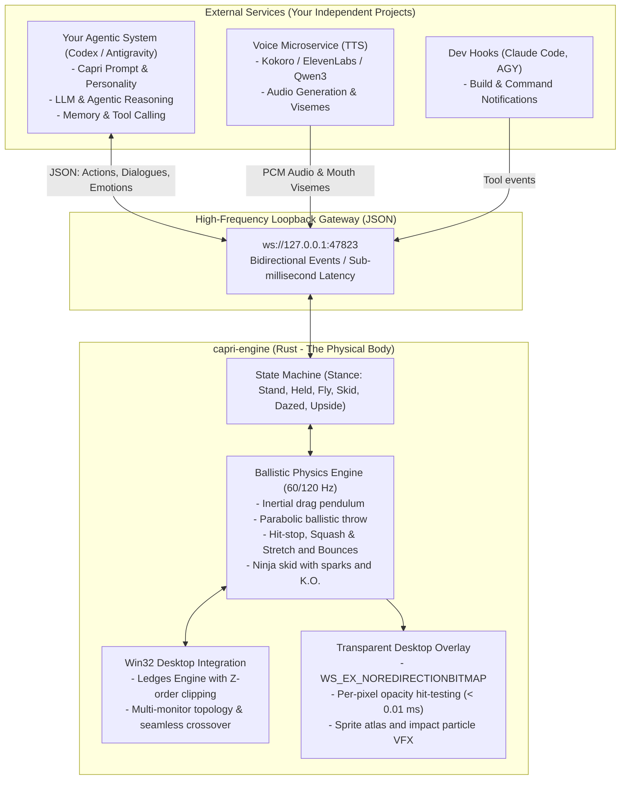

**English** · [Español](README.es.md)

# Capri Engine (`capri-engine`)
### Ballistic Physics Engine, Desktop Canvas, and Modular Gateway for AI Constructs

[](https://www.rust-lang.org/)
[](LICENSE.md)
[]()
[]()

> **Capri Engine** is the **Embodied Desktop Host & Physics Canvas** for **Capri** (*Project Capricorn*, from *Cyberpunk: Edgerunners*).
>
> Built in **native Rust** with a modular, service-oriented architecture, it fully decouples high-frequency physical simulation and transparent window rendering from the artificial intelligence brain (LLM) and voice services (TTS/STT).

---

## 1. Architecture Philosophy: Body vs. Mind Decoupling

Capri Engine implements a decoupled architecture where the native physics simulation and rendering engine runs as an independent high-performance process (the physical body), communicating with external AI agents, voice services (TTS), and developer tools exclusively through a high-speed loopback WebSocket gateway (`ws://127.0.0.1:47823`).

This separation guarantees that desktop physics simulation and interactivity remain smooth at 60/120 FPS without blocking, regardless of the response time or processing workload of external language models and cognitive services.



### Architecture Benefits:
- **Designed for fluid interaction**: Rendering follows display VSync at a configurable 60/120 Hz target. Engine-owned sprite residency targets 25 MiB; total process and GPU-driver memory are measured separately.
- **Polyglot flexibility**: Your agent can be written in Python, TypeScript, Go, or C#; it only needs to exchange JSON over WebSocket.
- **Fault isolation**: If the AI model takes seconds to respond or TTS fails, Capri keeps swaying, bouncing, and sitting naturally on your desktop without stuttering.

---

## 2. V1 Scope and Implementation Status

The table below tracks the implementation status of all core systems across physics, desktop integration, rendering, and the communication gateway:

| Category | Feature / Mechanic | Specification & Details | Status |
| :--- | :--- | :--- | :--- |
| **Physics** | Drag & Inertial Pendulum (`Held`) | Relative anchor point, angular spring damping, render-space smear and echo | Completed |
| **Physics** | Ballistic Throw (`throwHer`) | Pointer velocity buffer, parabolic trajectory, tumbling spin, streak release | Completed |
| **Physics** | Collision & Impact Mechanics | Surface bounce restitution, 1-4 frame anime hit-stop, squash & stretch | Completed |
| **Physics** | Impact Particles (VFX) | Dynamic neon shockwave rings and spark particle bursts on contact | Completed |
| **Physics** | Ninja Skid Landing (`Skid`) | Sliding friction deceleration and spark emission on foot contact | Completed |
| **Physics** | Knockout K.O. (`Dazed`) | Head impact knockout state with orbiting 3D neon stars | Completed |
| **Physics** | Ceiling Suspension (`Upside`) | Screen ceiling hang pose with command-driven support | In Progress |
| **Physics** | Cursor Ride & Follow (`Ride`) | Stable cursor-follow pose driven by a gateway action | In Progress |
| **Physics** | Screen Corner Resting (`Corner`) | Specialized tucked perching stance in display corners | Pending |
| **Desktop** | Active Window Ledges Scan | Native Win32 enumeration (`EnumWindows`, `DwmGetWindowAttribute`) | Completed |
| **Desktop** | 1D Z-Order Ledges Subtraction | Interval clipping subtracting higher Z-order occlusions | Completed |
| **Desktop** | Ledge Perching Behavior (`Perch`) | Horizontal span collision, sit/lay-down loop, and freefall when support disappears | Completed |
| **Desktop** | Multi-Monitor Topology | Virtual coordinate mapping (`EnumDisplayMonitors`) | Completed |
| **Desktop** | Display Border Crossover | Seamless traversal across adjacent screens; boundary bouncing | Pending |
| **Render** | DirectComposition Overlay | Win32 transparent window (`WS_EX_NOREDIRECTIONBITMAP`, DX12/Vulkan) | Completed |
| **Render** | Per-Pixel Alpha Hit-Testing | RAM bitmask query in `WM_NCHITTEST` (< 0.01 ms, zero GPU readback) | Completed |
| **Render** | Sprite Animation Engine | Local clip clocks, priorities, transitions, flipped assets, speech overlays, and pose mapping | Completed |
| **Render** | Advanced WGSL Shaders | Full-screen post-processing (screen cracks, Relic chromatic aberration) | In Progress |
| **Gateway** | Asynchronous Tokio Loopback | Standalone WebSocket server listening on `ws://127.0.0.1:47823` | Completed |
| **Gateway** | Typed Inbound Protocol (Serde) | `speak`, `lip_sync`, `emotion`, `point_at`, `action` commands with visual speech wiring | Completed |
| **Gateway** | Typed Outbound Telemetry (Serde) | `avatar_grabbed`, `avatar_thrown`, `avatar_impact`, `avatar_landed`, `monitor_changed` | Completed |
| **Gateway** | Test & Verification Suite | Interactive client mock script (`scripts/agent_mock.js`) and unit tests | Completed |

---

### 2.1. Drag and Inertial Pendulum (`Held`)
- When clicking on Capri, the relative anchor point on her body is computed.
- **Damped angular spring physics**: Her body oscillates opposite to mouse acceleration (`tau = k * (theta_target - theta) - c * omega`).
- **Dynamic mane deformation**: Hair and silhouette dynamically stretch (*smear frames*) proportional to pointer velocity.

### 2.2. Ballistic Throw (`throwHer`)
- Real-time mouse velocity tracking. If released at a speed >= 650 px/s (up to 4200 px/s):
  - Enters a parabolic trajectory with gravitational acceleration (2200 px/s^2).
  - Multiplicative aerodynamic drag.
  - Angular tumbling spin velocity calculated from the horizontal throw vector.
  - Initial stretched streak frames (*streak release*).

### 2.3. Collisions, Bounces, and Deformation
- **Anime Hit-Stop**: 1 to 4 frame momentary freeze at contact to convey punchy impact force.
- **Squash & Stretch**: Elastic deformation proportional to impact energy along the surface normal, with oscillatory recovery.
- **Impact VFX**: Neon shockwaves, bounce sparks, and cracked screen glass effects.

### 2.4. Landings and Consequent States
- **Ninja Skid (`Skid`)**: If landing on her feet at moderate downward velocity, she slides across the floor or ledge braking with friction and emitting sparks before standing up.
- **Knockout K.O. (`Dazed`)**: Headfirst or violent crashes leave her lying on the surface with orbiting 3D neon stars, gradually shaking it off to regain composure.

### 2.5. Hanging Mechanics
- **Ceiling Hang (`Upside`)**: Jumping toward the top screen edge hooks her feet, leaving her suspended upside-down overlooking the desktop.
- **Cursor Ride (`Ride`)**: Capri grips or rides the mouse cursor as you work.
- **Monitor Corners (`Corner`)**: Resting poses tucked into screen corners.

---

## 3. Window Interaction and Multi-Monitor

### 3.1. Z-Order Ledges Engine
- Continuous scanning via native Win32 APIs (`EnumWindows` and `DwmGetWindowAttribute`).
- **1D Geometric interval subtraction**: Accurately subtracts overlapping regions from higher windows in the Z-order, computing exposed ledge segments.
- **Ledge Perching Behavior (`Perch`)**:
  - Capri sits or lies down on the exposed upper rim of the active window.
  - As the window moves or resizes, Capri moves with it rigidly.
  - If the window minimizes, closes, or is occluded, Capri loses her footing and falls under gravity (`fall`).

### 3.2. Multi-Monitor Topology and Border Crossover
- Virtual desktop coordinate space mapping via `EnumDisplayMonitors`.
- **Seamless border crossover (`crossOver`)**: Throws directed toward adjacent monitors pass cleanly across display boundaries; throws directed toward virtual desktop boundaries bounce off with impact.

---

## 4. WebSocket API Specification (`ws://127.0.0.1:47823`)

The asynchronous loopback server accepts connections from any WebSocket client and uses a typed JSON protocol.

### 4.1. Incoming Commands (To Capri)

#### Request an action or stance change
```json
{
  "type": "action",
  "action": "hang_on_ceiling"
}
```

#### Request speech (dialogue balloon)
```json
{
  "type": "speak",
  "text": "System online. Awaiting your instructions.",
  "duration_ms": 3500
}
```

#### Send mouth viseme (TTS Lip-Sync)
```json
{
  "type": "lip_sync",
  "viseme": 2
}
```

#### Change emotional state
```json
{
  "type": "emotion",
  "state": "happy"
}
```

#### Point at a screen position
```json
{
  "type": "point_at",
  "screen": 0,
  "x": 1920,
  "y": 1080
}
```

---

### 4.2. Outgoing Telemetry Events (From Capri to Your Agent)

#### Capri was grabbed with the mouse
```json
{
  "event": "avatar_grabbed",
  "x": 512.0,
  "y": 800.0
}
```

#### Capri was thrown ballistically
```json
{
  "event": "avatar_thrown",
  "speed": 1850.5,
  "vx": 1200.0,
  "vy": -1400.0
}
```

#### Capri collided with a wall, ceiling, or window
```json
{
  "event": "avatar_impact",
  "speed": 1640.0,
  "normal_x": -1.0,
  "normal_y": 0.0,
  "window_title": null
}
```

#### Capri landed on the floor or a ledge
```json
{
  "event": "avatar_landed",
  "surface": "window",
  "window_title": "Visual Studio Code",
  "x": 960.0,
  "y": 420.0,
  "skid": true
}
```

#### Capri crossed to another monitor
```json
{
  "event": "monitor_changed",
  "screen_index": 1,
  "screen_name": "\\\\.\\DISPLAY2"
}
```

---

## 5. Agent Integration Example (Node.js or Python)

### In Node.js (`scripts/agent_mock.js`):
```javascript
const ws = new WebSocket('ws://127.0.0.1:47823');

ws.on('open', () => {
    console.log('Connected to Capri Engine!');
    
    // Command Capri to speak
    ws.send(JSON.stringify({
        type: 'speak',
        text: 'Successful Rust build!',
        duration_ms: 3000
    }));
});

ws.on('message', (data) => {
    const event = JSON.parse(data.toString());
    if (event.event === 'avatar_thrown') {
        console.log(`User threw Capri at ${event.speed} px/s!`);
    }
});
```

---

## 6. Build and Run

### Prerequisites:
- **Operating System**: Windows 10 or Windows 11 (x64).
- **Rust Toolchain**: Rust 1.85+ (2024 edition supported).
  ```powershell
  winget install Rustlang.Rustup
  rustup default stable-x86_64-pc-windows-msvc
  ```

### Run Automated Tests:
```powershell
cargo test
```

### Run Capri Engine:
```powershell
cargo run --release
```

The render target defaults to 60 Hz. Set `CAPRI_TARGET_FPS=120` to request the 120 Hz cadence on compatible displays.

### Test with Mock Agent:
In another terminal while `capri-engine` is running:
```powershell
node scripts/agent_mock.js
```

---

## 7. License

This project is licensed under the **PolyForm Noncommercial License 1.0.0** ([LICENSE.md](LICENSE.md)). Free for noncommercial personal, educational, fan-work, and open-source projects.
